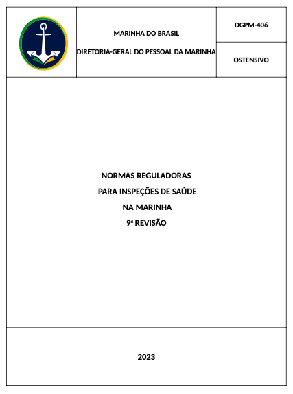
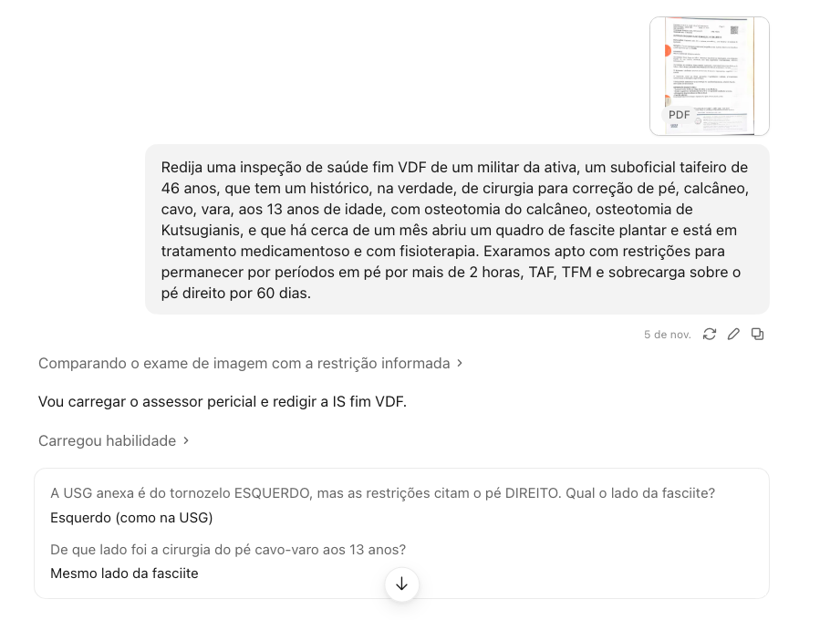
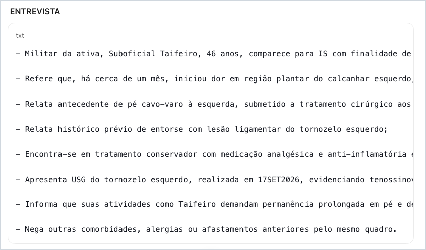
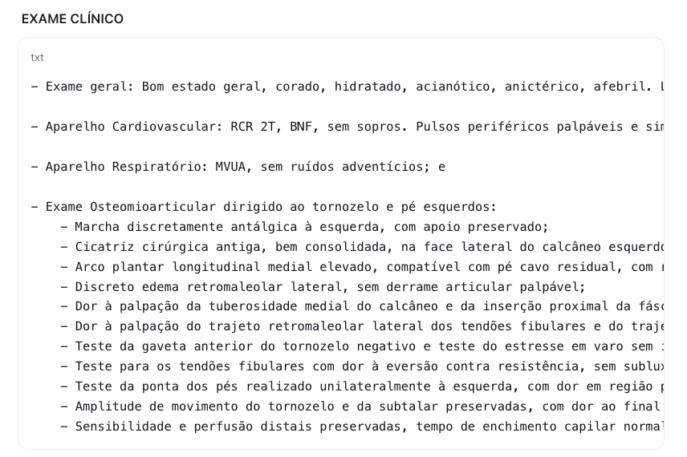
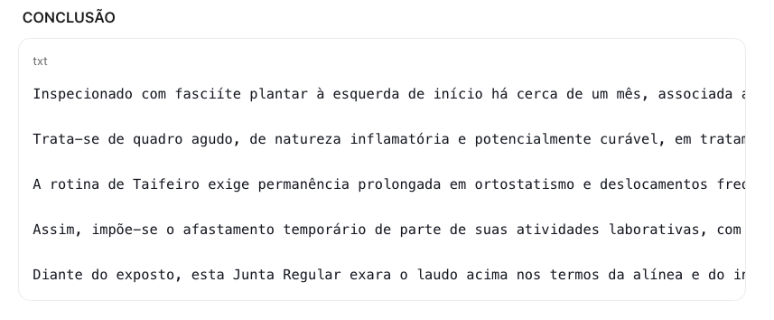

# assessor-pericial-dgpm406

  

 
Skill para Claude que assessora a redação de documentos médico-periciais de Inspeção de Saúde (IS) com base na **DGPM-406 (9ª Revisão)**, normas da Marinha do Brasil, e na legislação correlata.
 
A skill atua como assessor normativo: esclarece dúvidas sobre procedimentos, competências, finalidades e formatos de laudo, e ajuda a redigir entrevista, exame clínico e conclusão de IS, sempre com citação da norma de origem.
 
> **Aviso:** esta é uma ferramenta de apoio à redação e à consulta normativa. Não é publicação oficial da Marinha do Brasil nem substitui a análise do médico-perito, a norma vigente nem a orientação de órgão competente. Confira sempre o texto no documento oficial antes de utilizá-lo em um ato administrativo.
 
## O que a skill faz
 
- Responde dúvidas sobre a DGPM-406: competência de Juntas, tipos e finalidades de IS, Atestado de Origem (AO), VDF, término de incapacidade e restrições, saídas, recursos e revisão.
- Conduz uma entrevista prévia para levantar os dados que a finalidade exige (vínculo, posto ou graduação, idade, diagnóstico, rotina de trabalho).
- Escolhe o laudo cabível para cada finalidade e vínculo, com base em `referencias/formas-conclusao.json`.
- Redige os três blocos de uma IS (entrevista, exame clínico e conclusão), com a frase de encerramento e o referenciamento normativo.
- Enquadra benefícios conforme a Portaria GM-MD nº 3.551/2021 (doenças especificadas em lei).
- Converte código CID-10 em nome oficial da doença, usando tabela local.
## Gatilhos e exemplos de uso

Cada gatilho aciona um fluxo diferente da skill. Os exemplos abaixo são ilustrativos; use dados hipotéticos.

| Gatilho | Exemplo de mensagem | O que a skill faz |
|---|---|---|
| Dúvida normativa | "O que a DGPM-406 diz sobre a competência da JRS para IS de Ingresso?" | Localiza o capítulo ou o anexo e responde com a citação da norma |
| Redação de IS | "Redija uma IS de Controle Periódico de um militar de 45 anos, sem comorbidades" | Aplica a entrevista prévia e produz os três blocos: entrevista, exame clínico e conclusão |
| Escolha de laudo | "Qual laudo cabe para uma IS de Término de Restrições de um Sargento da ativa?" | Consulta `formas-conclusao.json` e indica só os laudos permitidos para a finalidade e o vínculo |
| Procedimento | "Guie o procedimento de recurso de primeira instância numa IS de Ingresso" | Descreve as etapas, com a fonte de cada uma |
| Ingresso normal | `# EFOMM MASC 18` | Gera direto a IS de Ingresso com aptidão, sem entrevista prévia |
| Código CID | "Qual o nome oficial da doença do CID M51.1?" | Consulta a tabela local `cid10.json` e responde com o nome da doença |
| Assinatura | `#ASSINATURA` | Retorna o bloco de assinatura, com data no formato DDMMMAAA |
| Correção durável | `# ATENÇÃO! INFORMAÇÃO PARA CONHECIMENTO:` seguido do texto | Registra a correção em `correcoes.md` e aplica a regra nas respostas seguintes |

## Exemplo de uso

Caso fictício, usado para ilustrar o fluxo de uma IS de Verificação de Término de Restrições (fim VDF), do pedido à conclusão.

**1. Pedido ao Claude**

**2. Bloco de entrevista**

**3. Exame clínico**

**4. Conclusão**

**Conclusão na íntegra:**

> "Inspecionado com fasciíte plantar à esquerda de início há cerca de um mês, associada a tenossinovite do flexor longo do hálux e dos fibulares, em pé com antecedente de correção cirúrgica de deformidade em cavo-varo na adolescência, achados confirmados pela USG de 17SET2026 e coerentes com o exame físico, que evidencia dor à palpação da inserção calcânea da fáscia plantar e dos trajetos tendíneos, marcha discretamente antálgica e tornozelo sem instabilidade ligamentar.

> Trata-se de quadro agudo, de natureza inflamatória e potencialmente curável, em tratamento medicamentoso e fisioterápico com resposta parcial, que não justifica afastamento total do trabalho, mas cuja evolução é agravada pela carga mecânica sobre o retropé esquerdo.

> A rotina de Taifeiro exige permanência prolongada em ortostatismo e deslocamentos frequentes durante a jornada, o que sobrecarrega a fáscia plantar e os tendões acometidos, perpetuando a inflamação e retardando a recuperação. Da mesma forma, a corrida, os saltos e os exercícios de impacto inerentes ao TAF e ao TFM são incompatíveis com a fase atual do tratamento.

> Assim, impõe-se o afastamento temporário de parte de suas atividades laborativas, com restrições para permanecer em pé por períodos superiores a duas horas, para TAF, TFM e sobrecarga sobre o pé esquerdo, por 60 dias, período suficiente para a conclusão da fase inicial do tratamento conservador e reavaliação da resposta clínica, devendo o militar ser inscrito pela OM no programa de reabilitação das deficiências funcionais.

> Diante do exposto, esta Junta Regular exara o laudo acima nos termos da alínea e do inciso 6.1.4 e da alínea b do inciso 6.3.1 da DGPM-406 (9ª Rev)."

---

## Conteúdo
 
| Caminho | Conteúdo |
|---|---|
| `SKILL.md` | Instruções principais, hierarquia de fontes e regras de redação |
| `INSTALL.md` | Estrutura detalhada e instruções de instalação |
| `referencias/dgpm-406/` | Texto-fonte dos Capítulos 1 a 18, índice temático e tabela dos Anexos |
| `referencias/dgpm-406/anexos/` | Anexos N, O, U e V transcritos, com versões estruturadas em JSON para N e O |
| `referencias/portaria-3551-2021/` | Texto da Portaria, um arquivo por doença |
| `referencias/enquadramento-beneficio.md` | Critérios de enquadramento em benefícios |
| `referencias/redacao-pericial.md` | Formato dos blocos de IS, transcrições e bloco de assinatura |
| `referencias/roteamento-finalidade.md` | Capítulo ou norma aplicável por finalidade e vínculo |
| `referencias/formas-conclusao.json` | Laudos permitidos por finalidade e vínculo, com condições de uso e verificações |
| `referencias/entrevista-previa.md` | Entrevista prévia: dados a levantar antes de redigir uma IS |
| `referencias/gatilho-ingresso-normal.md` | Atalho para IS de Ingresso sem alterações (`# CONCURSO SEXO IDADE`) |
| `referencias/cid10.json` / `cid10.md` | Tabela CID-10 local |
| `referencias/exemplos.md` | Casos-modelo para calibrar a resposta |
 
## Instalação

1. **Baixe a skill:**
   - Clone o repositório: `git clone https://github.com/Mauriston/assessor-medico-pericial-mb.git`
   - Ou baixe o ZIP pelo botão **Code** do repositório no GitHub.
2. **Instale no Claude:**
   - Claude.ai ou Cowork: em Configurações > Skills, clique em **Upload skill** e selecione a pasta compactada (ou o arquivo `.skill`).
   - Claude Code: copie a pasta para `~/.claude/skills/assessor-pericial-dgpm406`.
3. **Ative a skill:** ligue a skill **assessor-pericial-dgpm406** na lista de skills.
4. **Teste:** peça ao Claude: "O que a DGPM-406 diz sobre a competência da JRS para IS de Ingresso?"

Detalhes de estrutura e de instalação em [`INSTALL.md`](INSTALL.md).

## Fontes e limites
 
- **Anexos não transcritos:** os Anexos A a M, P a T e W a AB (majoritariamente formulários DS-1 a DS-8 e tabelas de uso pontual) não estão no pacote. Quando for preciso citação literal deles, a skill usa o PDF da DGPM-406 incluído em `referencias/dgpm-406/DGPM-406-9a-rev.pdf`.
- **Transcrições:** os textos de Portaria e de Anexos foram convertidos de PDF para Markdown. Confira no texto publicado os limiares numéricos que decidam um enquadramento.
- **Normas externas:** se o usuário anexar a norma, ela é usada como fonte prioritária. Na falta, a skill pode fazer busca controlada em fontes oficiais.
## Privacidade
 
Não insira no chat nomes completos, números de identificação pessoal nem dados de saúde reais. Use dados hipotéticos ao testar ou ao redigir modelos.
 
## Contribuição
 
Correções de transcrição, atualizações normativas e novos casos de calibração são bem-vindos por *issue* ou *pull request*. Ao propor uma correção, indique a norma ou a publicação oficial de referência.
 
## Licença

O código e a documentação desta skill (arquivos `SKILL.md`, `INSTALL.md`, `README.md` e os resumos e ferramentas em `referencias/`) são distribuídos sob a licença MIT, conforme o arquivo [`LICENSE`](LICENSE).

**Esta licença não se aplica às normas citadas.** A DGPM-406 (9ª Revisão), a Portaria GM-MD nº 3.551/2021, as leis e as demais normas reproduzidas ou resumidas em `referencias/` são atos oficiais de seus respectivos órgãos. Os textos aqui transcritos servem à consulta e à redação, não substituem a publicação oficial e não passam a integrar a licença MIT. Consulte sempre o texto vigente no Diário Oficial ou na fonte normativa original.
